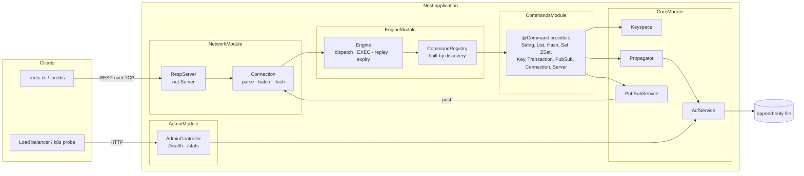
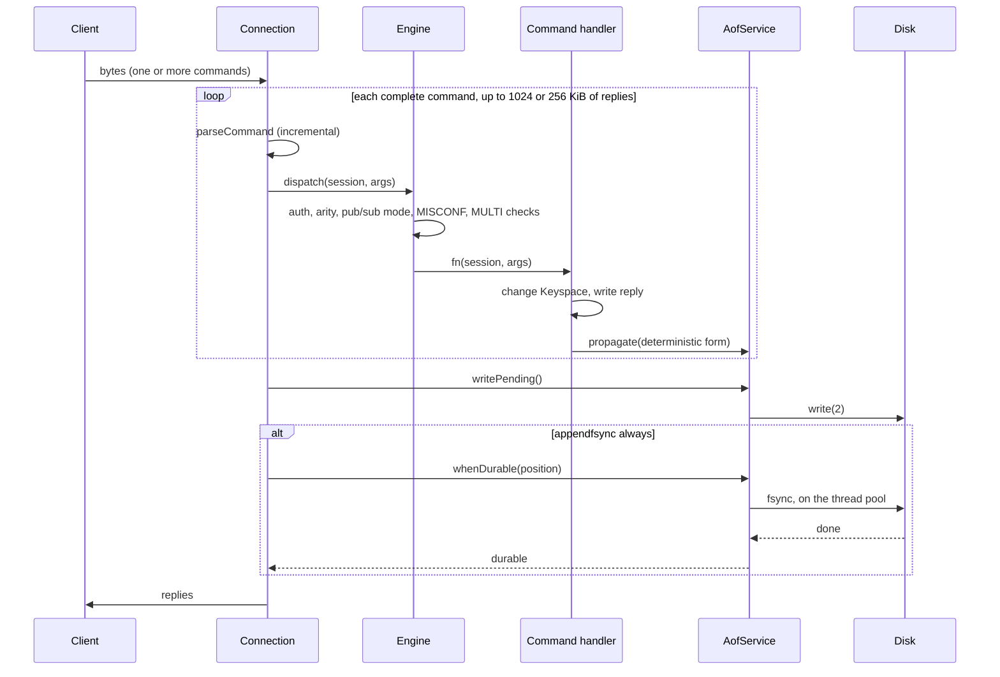
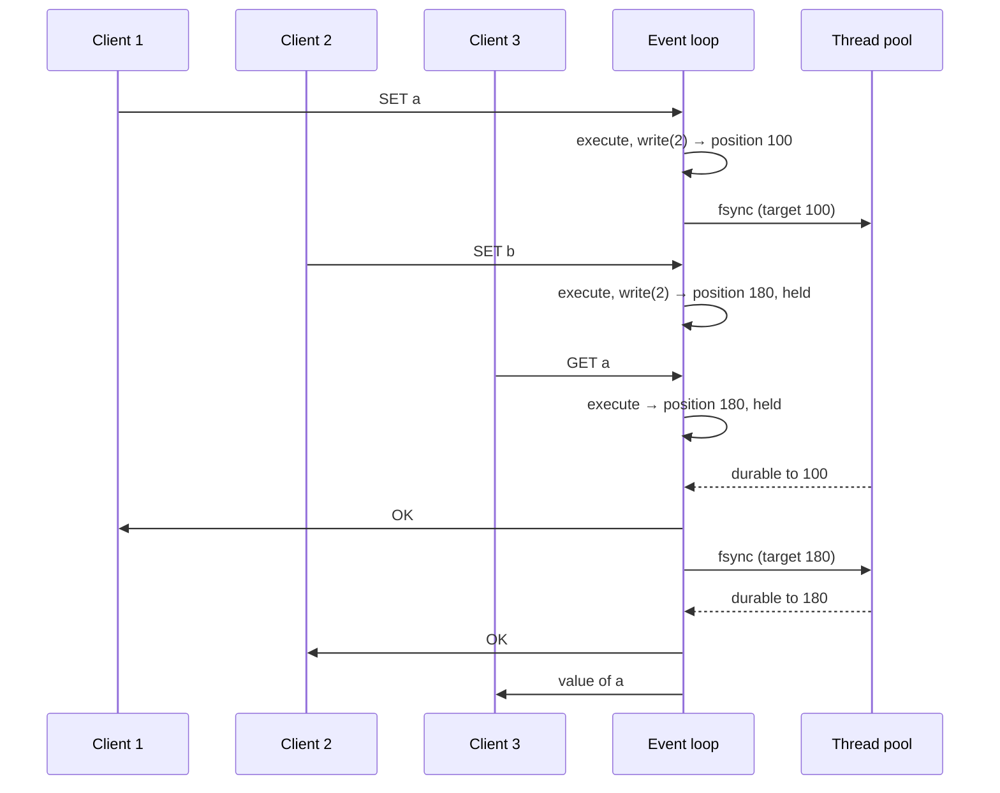
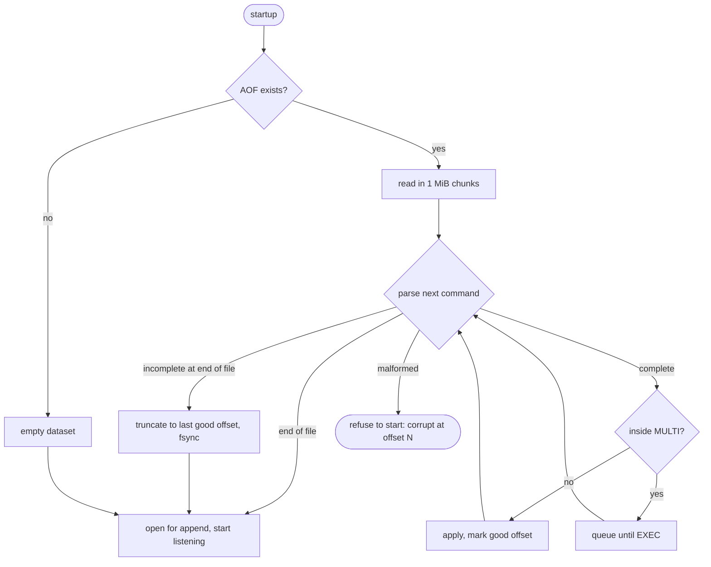
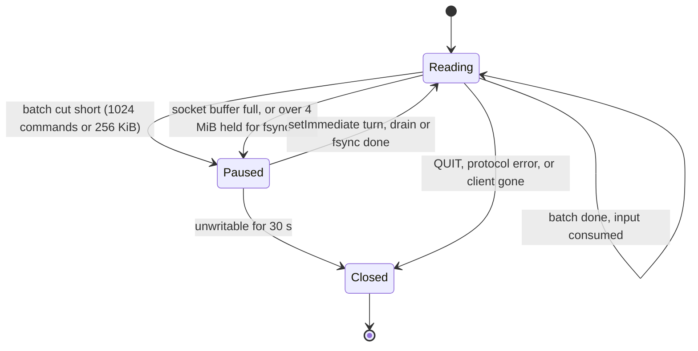

# nest-respkv design

A Redis-compatible key-value server built on NestJS. It is a port of [go-respkv](https://github.com/neerajsinghi/go-respkv): same commands, same AOF format, same durability promises. This document covers how those promises are kept on a single-threaded runtime, and what NestJS is and isn't used for.

The short version: Nest owns the structure (modules, dependency injection, lifecycle, command discovery, the HTTP admin API), and the hot path is plain synchronous TypeScript that Nest never sees per command.

## 1. Requirements

### Functional

- Speak RESP2, so `redis-cli`, `redis-benchmark` and client libraries such as `ioredis` work unchanged.
- Strings, lists, hashes, sets and sorted sets, with the commands in [COMMANDS.md](COMMANDS.md).
- Key expiry with second and millisecond precision.
- Persistence through an append-only file (AOF), with Redis's three fsync policies.
- `MULTI`/`EXEC` transactions and channel pub/sub.
- Optional password authentication.
- HTTP health and stats endpoints for orchestrators.

### Non-functional

- **Atomicity.** Each command, and each `EXEC`, runs with no other command interleaved.
- **Durability.** Under `appendfsync always`, no acknowledged write is lost to a power cut. Under any policy, none is lost to a crash of the process.
- **Isolation between clients.** A slow disk, or a client that stops reading, mustn't stall anyone else or grow memory without bound.
- **Compatibility you can check.** A differential test compares replies against a real `redis-server`.

### Non-goals, for now

Replication, clustering, eviction, `SCAN`, `WATCH`, blocking commands, Lua, RESP3 and TLS. Section 13 covers how each would fit.

## 2. Architecture

| Module | Providers | Job |
|---|---|---|
| `ConfigModule` | `RESPKV_CONFIG` | Typed configuration from environment variables, validated at startup |
| `CoreModule` | `Keyspace`, `AofService`, `Propagator`, `PubSubService`, `ServerStats` | State shared by commands and the engine |
| `EngineModule` | `CommandRegistry`, `Engine` | Dispatch, transactions, AOF replay, active expiry |
| `CommandsModule` | ten command providers | Every command, as methods marked `@Command` |
| `NetworkModule` | `RespServer` | The TCP listener and per-connection state |
| `AdminModule` | `AdminController` | `GET /health` and `GET /stats` over HTTP |

### What Nest does here

- **Dependency injection and modules.** Command providers get the keyspace, the propagator and so on through constructors, and tests can build the whole app or override pieces with `Test.createTestingModule`.
- **Command discovery.** `@Command('SET', { arity: -3, write: true })` on a method is all it takes to add a command. At startup, `CommandRegistry` walks every provider with Nest's `DiscoveryService` and `MetadataScanner` and builds a name-to-handler map. It refuses async handlers, because they would break atomicity (section 4).
- **Lifecycle.** `onApplicationBootstrap` replays the AOF before anything listens; `beforeApplicationShutdown` drains client connections; `onApplicationShutdown` fsyncs and closes the log afterwards. `enableShutdownHooks` wires these to SIGTERM.
- **HTTP.** The admin endpoints are an ordinary Nest controller on a separate port.

### What Nest doesn't do here

It isn't in the per-command path. No guards, interceptors, pipes or request-scoped providers run per command, and the TCP server isn't a Nest microservice transport. Those all deliver each message to an async handler returning an Observable or a Promise, which would hand control back to the event loop in the middle of a command. [ADR 0002](adr/0002-commands-as-providers.md) has the reasoning. The cost of Nest is paid once, at startup.

## 3. Request lifecycle

Everything from parsing to writing the AOF is one synchronous run of JavaScript. The only waits are the fsync, which happens off the event loop, and the socket.

## 4. Execution model

Node runs JavaScript on one thread. The engine takes that as its concurrency model instead of fighting it: a command handler is synchronous from start to finish, so nothing else can run until it returns. That is what makes every command atomic, and `EXEC` atomic too, because it runs the whole queue in one call. There are no locks anywhere. [ADR 0001](adr/0001-event-loop-execution.md) compares this with go-respkv's global mutex.

The rule has to hold for every handler, so it's enforced: the registry refuses to start if a `@Command` method is an `async` function, and handlers never take callbacks. Anything slow (fsync, socket writes) happens after the batch, outside any command.

Single-threaded execution still needs fairness between clients:

- **Batches.** A connection runs up to 1024 commands, or until its replies reach 256 KiB, and then yields with `setImmediate`, so other connections' I/O gets a turn. A pipeline of large `GET`s therefore can't monopolise the loop.
- **Long commands.** `KEYS` over a big keyspace and `REWRITEAOF` block everyone, as they do in Redis. They're documented as such.

What this model can't do is use more than one core for commands. go-respkv had the same limit for a different reason, a global lock, and Redis has it by design. Section 10 has the numbers.

## 5. Data model

| Type | Representation | Notes |
|---|---|---|
| string | JS string | Latin1: one character per byte |
| list | `Deque<string>` | Ring buffer; push and pop at both ends and index access are O(1) |
| hash | `Map<string, string>` | |
| set | `IndexedSet<string>` | Array plus index map, so `SPOP` picks a uniform random member in O(1) |
| zset | `ZSet` | Map for scores plus a skip list with spans, as in Redis |

**Why strings rather than Buffers.** Every key, value, field and member is a latin1 string, which maps each byte to one character, so binary data round-trips exactly. Strings beat Buffers here for three reasons:

1. Map keys have to be strings anyway, and a hash field or set member is a key.
2. Small Buffers are slices of shared 8 KiB slabs, so keeping a 5-byte value alive would keep its whole slab alive. Strings have no such sharing.
3. V8 stores latin1 strings at one byte per character, and represents `APPEND` as a rope rather than copying.

The cost is one copy when parsing and one when writing a reply, and a ceiling of 536,870,888 bytes per value (V8's longest string), 24 bytes short of Redis's 512 MiB. [ADR 0004](adr/0004-latin1-strings.md) covers the alternatives.

**Keyspace.** Values live in one `Map`. Expiry times live in a separate `ExpiryIndex`, as Redis keeps a separate `expires` dict, so keys without a TTL cost nothing extra. `ExpiryIndex` is an array of keys, an array of times and a map from key to position, which allows O(1) random sampling for active expiry.

**Numbers.** Integer commands use BigInt, so `INCR` is exact over all of int64, and parsing is as strict as Redis's: `007`, `+1` and `-0` are not integers. Expiry times are JS numbers, which are exact up to 2^53 ms (about 285,000 years from now). An expiry beyond that is rejected, where Redis would accept it.

## 6. Expiry

Two halves, as in Redis:

- **Lazy.** Every read goes through `Keyspace.get`, which deletes a key whose time has passed. No caller ever sees an expired value.
- **Active.** Every 100 ms the engine samples 20 random keys that have a TTL and deletes the expired ones. If more than a quarter of the sample was expired, it samples again, within a 2 ms budget, so a mass expiry is cleaned up quickly without stalling the loop.

`DBSIZE` and `INFO` count expired keys that haven't been collected yet, as Redis does.

## 7. Persistence

### What is logged

Every successful write is appended to the AOF as a plain RESP command, in a form that replays the same way regardless of when replay happens:

| Command | Logged as |
|---|---|
| `EXPIRE`, `PEXPIRE`, `EXPIREAT` | `PEXPIREAT key <absolute ms>` |
| `SET ... EX/PX/EXAT`, `SETEX`, `PSETEX` | `SET key value PXAT <absolute ms>` |
| `SPOP` | `SREM key <the members actually removed>` |
| an expiry with a past time | `DEL key` |
| a key removed because its TTL passed | `DEL key` |
| `MULTI` ... `EXEC` with writes | the writes, between `MULTI` and `EXEC` |

Failed commands, no-ops and read-only transactions log nothing. The format is byte-for-byte the one go-respkv writes, so either server can load the other's file.

### Why expiry is logged, and replay ignores the clock

If replay decided expiry from the clock, the dataset after a restart would depend on when the restart happened. Worse, a `SET` that happened after a key expired might replay before the key was considered expired. So replay sets `Keyspace.loading`, which turns expiry off, and the log itself records every expiry as a `DEL`. A key whose TTL passed while the server was down is expired normally, and logged, the first time it's touched after startup. The Go version's [ADR 0002](https://github.com/neerajsinghi/go-respkv/blob/main/docs/adr/0002-aof-records-expiry.md) has the full argument.

### Durability options

| `RESPKV_APPENDFSYNC` | Process crash | Power cut | Cost |
|---|---|---|---|
| `always` | nothing lost | nothing acknowledged is lost | one fsync per group of writes |
| `everysec` (default) | nothing lost | about the last second | a background fsync each second |
| `no` | nothing lost | whatever the OS hadn't flushed | none |

A process crash loses nothing under any policy because the log is written with a synchronous `write(2)` before the replies of a batch leave. Only the fsync is ever deferred.

### Group commit, and holding replies

`fs.fsync` runs on libuv's thread pool, so while one fsync is in flight the event loop keeps executing other clients' commands and appending their records. When it finishes, the next fsync covers all of those at once. Throughput under `always` therefore grows with the number of concurrent writers, where one fsync per write would be capped by the disk.

Every outgoing byte is tagged with the log position at the moment it was produced, and held until that position is durable. That includes replies to reads (client 3 above): a read can observe another client's write, and mustn't report it before it's durable, or a power cut could make the reader's view of the data disappear. When nothing is waiting on the disk, a read's position is already durable and its reply goes straight out. Pub/sub messages follow the same rule. Output never overtakes held output, so each connection's replies stay in order. [ADR 0003](adr/0003-group-commit.md) explains why this design was chosen.

### When the log fails

A failed `write` or `fsync` is sticky. From then on:

- write commands get `-MISCONF` and `EXEC` with a write gets `-EXECABORT`;
- reads keep working, so data can still be read out;
- a connection whose batch hit the failure, or whose replies were waiting on an fsync that failed, is closed without a reply, because its writes may not be on disk;
- `INFO` shows `aof_last_write_status:err` and `GET /health` returns 503, so an orchestrator can take the instance out of service.

Recovering takes a restart, as it does for go-respkv. Writing past a failed write would put a hole in the middle of the file.

### Recovery

A torn final command, or a final `MULTI` with no `EXEC`, is what a crash in the middle of a write leaves behind. Those writes were never acknowledged, so they're cut off. Anything else malformed is real corruption, and the server refuses to guess.

### Compaction

`REWRITEAOF` writes the smallest commands that rebuild the dataset (one `SET`, or `RPUSH`/`HSET`/`SADD`/`ZADD` in chunks of 1024 elements, plus `PEXPIREAT` for TTLs) to a temporary file, fsyncs it, renames it over the log and fsyncs the directory. A crash at any point leaves one complete log. It's synchronous: at 950,000 keys it blocks every client for about a third of a second. A background rewrite would need a copy-on-write snapshot, which Redis gets from `fork` and Node doesn't offer, so it's on the roadmap rather than here.

## 8. Transactions and pub/sub

### MULTI/EXEC

Commands after `MULTI` are checked (arity, unknown command) and queued. `EXEC` runs the queue in one synchronous call. A command rejected while queueing aborts the whole transaction with `EXECABORT`; a command that fails while running doesn't undo the others, as in Redis. The log brackets the transaction's writes with `MULTI`/`EXEC`, so replay drops a transaction that a crash wrote only half of.

### Pub/sub

`PUBLISH` encodes the message once and pushes the same Buffer to every subscriber's connection. Pushes go through the same ordered output path as replies, so a subscriber always sees its `SUBSCRIBE` reply before any message. While subscribed, a client may only use `SUBSCRIBE`, `UNSUBSCRIBE`, `PING` and `QUIT`.

A subscriber that stops reading would otherwise make the server buffer messages forever. When its unsent backlog passes `maxOutboxBytes` (32 MiB), it's disconnected and counted in `rejected_clients`. Publishers never wait for subscribers.

## 9. Flow control

Each connection decides, after every batch, whether to keep reading:

Pausing the socket stops reading, so TCP flow control pushes back on a client that sends faster than it reads its replies. Memory per connection is bounded by roughly one batch of replies plus the socket buffer, plus at most 4 MiB of output held for an fsync. A client whose socket stays unwritable for 30 seconds is dropped.

## 10. Security and limits

| Limit | Value | Why |
|---|---|---|
| Arguments per command before AUTH | 10 | An unauthenticated client can't make the server allocate much |
| Argument size before AUTH | 16 KiB | Same |
| Arguments per command | 1,048,576 | Redis's limit |
| Argument size | 536,870,888 bytes | V8's longest string |
| Unparsed input per connection | 1 GiB | Same as Redis's query buffer limit |
| Connections | 10,000 | Configurable with `RESPKV_MAXCLIENTS` |

The parser validates a whole command before allocating anything, so announcing `*1000000` costs nothing until the arguments actually arrive. Limits switch from the unauthenticated to the full set on the very next command after `AUTH`, even within a pipeline.

The password comes from the `RESPKV_PASSWORD` environment variable, which keeps it out of the process list. It's compared by SHA-256 hash with `timingSafeEqual`, so timing reveals neither its content nor its length. Both listeners default to 127.0.0.1, and the server warns at startup if it listens beyond loopback without a password. Error messages that echo client input have line breaks replaced, so they can't inject a fake reply. There is no TLS: put it behind a TLS proxy or a private network.

## 11. Capacity

Measured on one M1 Max laptop with Node 23.4 (arm64), `redis-benchmark` 7.0.5 with 50 clients, client and servers on the same machine, all three servers measured in the same session.

### Throughput, requests per second

| | SET | GET | INCR | LPUSH | ZADD |
|---|---|---|---|---|---|
| nest-respkv | 95k | 101k | 100k | 101k | 102k |
| go-respkv | 90k | 90k | 87k | 90k | 90k |
| Redis 7.0.5 | 100k | 101k | 98k | 102k | 99k |

Without pipelining, all three land near 100k because `redis-benchmark`'s single client thread is the bottleneck, not the servers. Pipelining 16 commands per round trip shows the servers themselves:

| Pipeline of 16 | SET | GET |
|---|---|---|
| nest-respkv | 0.93M | 1.01M |
| go-respkv | 1.28M | 1.28M |
| Redis 7.0.5 | 1.08M | 1.27M |

With fsync, 50 concurrent clients:

| Policy | SET per second |
|---|---|
| `everysec` | 57k |
| `always`, 50 clients | 4.2k |
| `always`, 1 client | 180 |

`always` with one client is bounded by the disk's fsync latency (about 5 ms here). With 50 clients group commit covers many writes per fsync, so throughput is 23 times higher.

### Memory

Heap per key after one million random `SET`s with 16-byte keys and 10-byte values (about 950,000 distinct keys):

| | Bytes per key |
|---|---|
| nest-respkv | 145 |
| go-respkv | 153 |
| Redis 7.0.5 | 104 |

Node's default heap limit depends on the machine's memory, and is a few GiB at most. Raise it with `node --max-old-space-size=<MiB>` for larger datasets. There's no `maxmemory` or eviction yet.

### Time, at about 950,000 keys

| Operation | Time |
|---|---|
| `REWRITEAOF` (161 MB log → 48 MB) | 333 ms, blocking |
| Replay on startup (48 MB) | 1.0 s |

### Scaling

One process uses one core for commands. To scale out, run several instances and shard keys in the client, as with Redis without Cluster. Section 13 covers replication.

## 12. Failure modes

| What happens | Effect | How it's handled |
|---|---|---|
| Process crash, `kill -9` | Nothing acknowledged is lost, under any policy | The log is written before replies; a torn tail is truncated on restart. Checked by killing the server mid-write. |
| Power cut | Up to a second under `everysec`; nothing acknowledged under `always` | Group commit and held replies (section 7). Not tested on real power loss. |
| Disk full or I/O error | Writes refused with `MISCONF`, reads continue | Sticky failure, `/health` returns 503 |
| Corrupt AOF | Server refuses to start, naming the byte offset | Fix or truncate the file by hand |
| Client stops reading | Its connection pauses, then closes after 30 s | Flow control (section 9) |
| Subscriber falls behind | Disconnected at 32 MiB of backlog | Publishers unaffected |
| Huge `KEYS` or rewrite | Every client waits while it runs | Avoid `KEYS` in production; rewrite when quiet |
| SIGTERM | Clients get the replies to commands already run; unread input is dropped; then the log is fsynced and closed | Nest shutdown hooks; connections are force-closed after 5 s |

### Operating it

- Watch `GET /health` (200 or 503) and `GET /stats` (keys, clients, commands, expired keys, rejected clients, heap, AOF size).
- Rewrite the log when it grows far beyond the dataset: `redis-cli -p 6380 REWRITEAOF`.

## 13. Roadmap

| Feature | How it fits |
|---|---|
| Background rewrite | Write the snapshot in slices across event-loop turns, copying a key's old value aside the first time a write touches it before its slice is written |
| `maxmemory` and eviction | Sample keys like active expiry does; approximate LRU needs a per-key access clock |
| `SCAN` | Needs a cursor that survives inserts and deletes. JS `Map` has no positional access, so this means an ordered index next to it, or Redis's bucket cursor over a hash table of our own |
| `WATCH` | A per-key version, bumped on write, checked at `EXEC` |
| Blocking commands (`BLPOP`) | A wait list per key, woken by pushes, plus a timer |
| Replication | Stream the same records the AOF gets to replicas after an initial snapshot |
| RESP3, TLS | RESP3 adds reply types to `ReplyWriter`; TLS is `tls.createServer` instead of `net.createServer` |

### What I'd revisit as it grows

- **More than one core.** The event loop caps throughput at one core. Worker threads sharded by key would need a router and would lose cross-shard `MULTI`, the same trade-off Redis Cluster makes.
- **Memory per key.** JS strings and Map entries cost more than Redis's encodings. Small hashes and sets could use packed arrays, as Redis's listpacks do.
- **Rewrite blocking.** 333 ms at a million keys is fine; at ten million it isn't.

## 14. How it's verified

- **Unit tests** for the parser (every prefix of a command, limits, malformed input), the data structures (model tests against plain arrays and maps under thousands of random operations), number parsing and the AOF loader (torn tails, partial transactions, corruption).
- **End-to-end tests** start the whole Nest application and talk RESP over TCP: pipelining with bytes split one at a time, auth limits, transactions, expiry, pub/sub ordering, slow subscribers, a client that floods without reading, the client limit, restart replay of every type, `always` acknowledging only what's in the file, rewrite, and log failure with the health endpoint.
- **A differential test** sends 40,000 random commands from a small keyspace to this server and to a real `redis-server` and requires equivalent replies. It was checked by breaking `STRLEN` on purpose and watching it fail.
- **A client-library test** with `ioredis` 6: auth, binary values, pipelines, `MULTI` and pub/sub.
- **By hand:** `redis-cli`, `redis-benchmark`, and `kill -9` in the middle of a stream of acknowledged `INCR`s under `always` and `everysec`, followed by a restart that had every acknowledged increment.
